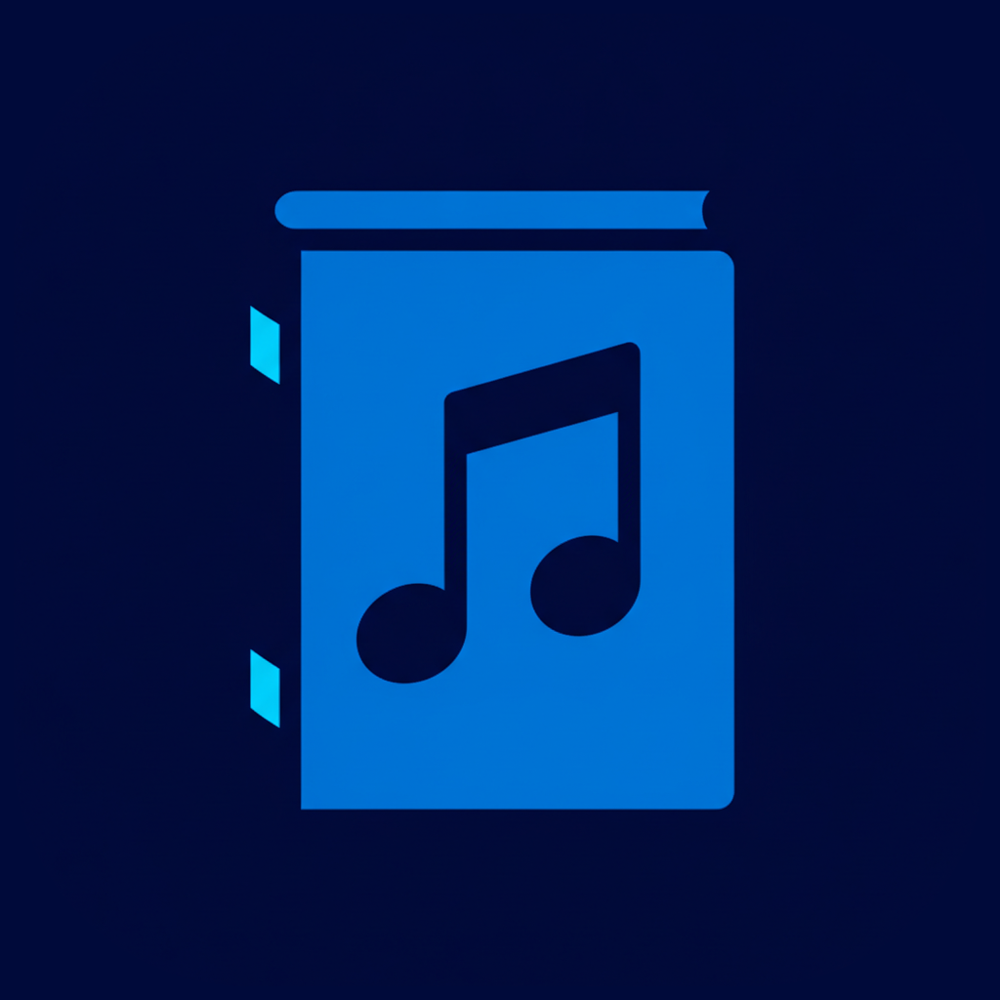

# MusiJournal

**Journal your day through song.**

MusiJournal is a daily journal built with Flutter. Users write about their day, pair it with a song,
and pick the emotion they felt most. The app then gives them a short AI reflection on how the song
connects to their day.

### App Store listing

**Name**

```
MusiJournal
```

**Subtitle**

```
Journal your day through song
```

**Promotional text**

```
Write about your day, pair it with a song, and get an AI reflection on how the music connects to how you felt. See your emotional patterns week by week.
```

**Keywords**

```
music,diary,mood,tracker,emotions,songs,reflection,self care,AI,wellness,daily,writing
```

**Categories:** Lifestyle (primary), Music (secondary)

**Description**

```
Some days are easier to explain with a song.

MusiJournal is a daily journal that brings together your words and your music. Write about your day, choose the song that fits it, and pick the emotion you felt most. MusiJournal then gives you a short AI reflection on how the song connects to your day.

WRITE YOUR DAY
Capture what happened and how it felt in a simple daily entry. Choose from Happy, Sad, Angry, or Neutral to record your main emotion.

PAIR IT WITH A SONG
Search for any song on Spotify, or choose one of your personalized recommendations, to go with your entry.

GET AN AI REFLECTION
Receive a brief analysis of the feelings in your entry, how your song relates to your day, and specific advice based on what you wrote.

SEE YOUR WEEK AT A GLANCE
Each entry gets an emotional intensity score from 1 to 100. Move between weeks on your home screen to see how your emotions change over time.

DISCOVER MUSIC YOU'LL LOVE
Get song recommendations based on your favorite genre, each with a range of emotions.

LOOK BACK ANYTIME
Search past journals by date to revisit an entry, along with its song and reflection. Tap Play on Spotify to hear that song again.

YOUR ACCOUNT, YOUR CHOICE
Sign in to keep your journals in your account. You can permanently delete your account and all of your journals from Profile Settings at any time.

To generate your reflection, the text of your journal entry is sent to OpenAI. Song playback opens in Spotify.

MusiJournal is intended for personal reflection. It is not a substitute for professional medical or mental health care.
```
